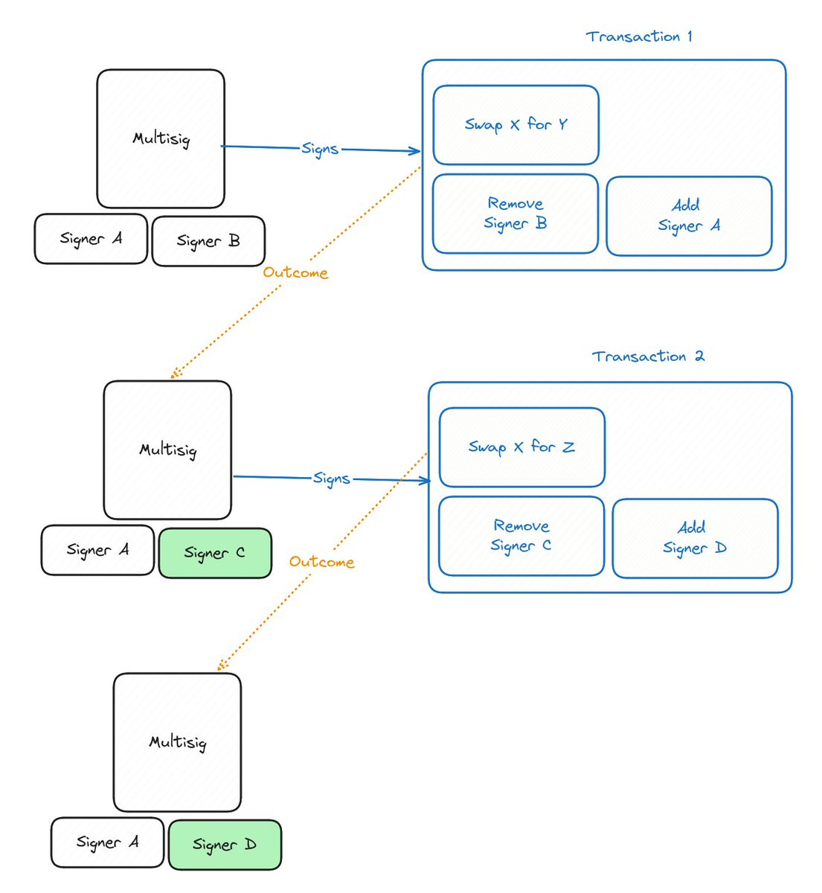
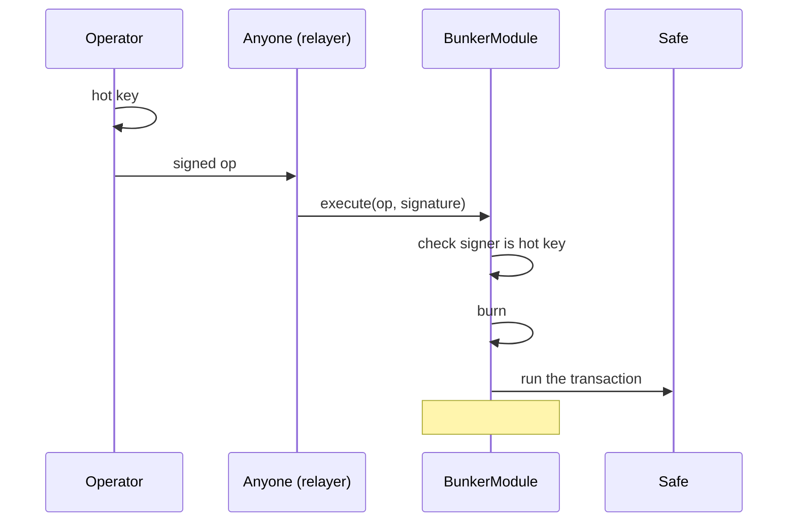

# bunker-safe-poc

A [Safe](https://safe.global) smart account where **every signing key is used exactly once**.
Proof of concept for "bunker mode": staying safe even if ECDSA keys become crackable.

> [!WARNING]
> **This is a proof of concept. It has not been audited** and is not deployed anywhere. Do not use
> it to hold real funds. It exists for research and discussion only.

## Background

- **Where "bunker mode" started:** [Justin Drake's call](https://x.com/drakefjustin/status/2107837081313505768)
  for the industry to plan for ECDSA breaking early. Move funds to addresses whose public keys are
  still hidden behind a hash, and have load-bearing signers rotate their ECDSA key with every
  signed message.
- **What inspired this design:** [@BlockEnthusiast's idea](https://x.com/BlockEnthusiast/status/2107897004265496742).
  Instead of moving all your funds to a new address every time you sign, keep the funds in a Safe
  and rotate the **signer**: every transaction does its work, adds the next signer, and removes the
  one that just signed.



*Design spec from the tweet. Signer A stays as a persistent backup, and the signing slot rotates
B → C → D. In Transaction 1, "Add Signer A" should read "Add Signer C" (a typo the author confirmed).*

This repo implements that idea with one change. The rotating key lives in a Safe **module** instead
of being a Safe owner:

| Spec | This repo |
|---|---|
| Signer A, a persistent backup owner | The break-glass owner. It never signs during normal operation |
| Rotating signer B → C → D | The module's hot key. Each signed operation names the next one |
| Add the new signer and remove the old one inside each transaction | The module burns the old key and installs the new one before the transaction runs, even if the transaction fails |

Rotating inside the module means rotation can't be forgotten, left out of a batch, or undone by a
failed transaction, and the backup key never has to sign to set it up.

## The problem

An Ethereum address is a hash of a public key. Until a key signs something, nobody knows its public
key, only the hash. The first signature reveals the public key, and from then on the key is
protected only by the hardness of ECDSA.

If ECDSA breaks (quantum computers, better math, or AI-driven cryptanalysis), any key that has ever
signed could be cracked from its public key. Keys that have **never** signed stay safe, because
their public key was never revealed.

## The idea

Never let a key with power over the funds stay valid after it reveals its public key.

- The Safe's only owner is a **break-glass key** that never signs during normal operation. Its
  public key stays hidden.
- Day-to-day operations are signed by a **hot key** held in a module. Each signed operation names
  the **next** hot key, and the module retires the current key in the same transaction that uses it.
- When an attacker could crack a revealed key, that key is already worthless.



## How it works

| Piece | What it does |
|---|---|
| `src/BunkerModule.sol` | Safe module. Holds the current hot key and runs operations signed by it. |
| `src/BunkerSetup.sol` | Installs the module while the Safe is being created, so the break-glass key never has to sign, not even once. |
| `script/DeployBunkerSafe.s.sol` | Deploys a bunker Safe on a local chain. |

An **operation** is one Safe transaction plus the rotation details:

```text
Op(address to, uint256 value, bytes data, uint8 operation,
   address nextHotKey, uint256 deadline, uint256 minPayloadGas)
```

- `to`, `value`, `data`, `operation`: a normal Safe transaction (0 = call, 1 = delegatecall).
  To do several things at once, delegatecall Safe's `MultiSendCallOnly`, the same format the Safe
  Transaction Builder produces.
- `nextHotKey`: the fresh key that takes over after this operation.
- `deadline`: after this time the transaction is skipped, but the key still rotates.
- `minPayloadGas`: the gas the relayer must provide, so nobody can burn your key while starving the
  transaction of gas.

It is signed as standard EIP-712 typed data (domain name `BunkerModule`, version `1`), so hardware
wallets and `cast wallet sign --data` work.

Anyone can submit a signed operation; there is no special relayer. The module then:

1. checks the signature comes from the current hot key;
2. **burns that key and installs `nextHotKey`**;
3. runs the transaction through the Safe.

The key rotates before the transaction runs and no matter how it ends. If the transaction fails,
its effects are rolled back, but the old key stays burned.

### The rule the module guarantees

> Once a hot-key signature is public, anyone can submit it, and every submission that succeeds
> burns that key.

| What happens | Result |
|---|---|
| Transaction succeeds | `Executed`, key rotated |
| Transaction (or any call in a batch) fails | `PayloadReverted`, effects rolled back, key rotated |
| Deadline passed | `Expired`, transaction skipped, key rotated |
| `operation` is not 0 or 1 | `InvalidOperation`, transaction skipped, key rotated |
| `nextHotKey` is zero or was used before | `Frozen`: the module locks until the Safe owner resets it |
| Signer is not the current hot key (replay, wrong key, wrong chain) | reverts with `NotHotKey`. Nothing to protect: that signature has no power |
| Relayer sends too little gas | reverts with `InsufficientGas`. The signature is still valid; anyone can resubmit with more gas |

There is no nonce. Each key signs once, and a burned key can never be reinstated, so old signatures
can never be replayed.

## Who is trusted

- **The operator** (whoever holds the hot keys) is trusted with the Safe. The module does not limit
  what a transaction can do; the operator could drain the Safe anyway. If you need limits, route
  transactions through a [Zodiac Roles](https://github.com/gnosisguild/zodiac-modifier-roles)
  modifier.
- **The attacker** is someone who can crack a key from its public key, but slowly: much slower than
  it takes a transaction to land on-chain. By the time they recover a key, it is burned. They also
  can't change a pending operation, because the signature covers the whole transaction.

## Emergency access (break glass)

If hot keys are lost or compromised, the break-glass owner signs one normal Safe transaction that:

1. sets a new hot key (or freezes the module), **and**
2. replaces the break-glass owner with a fresh address.

Signing reveals the break-glass key's public key, so the same transaction must retire it. See
`test_breakGlass_resetsHotKeyAndRotatesOwnerAtomically`.

## What you must get right

- **Hot keys must be truly fresh.** The contract can't tell whether a key has signed before. Never
  use a hot key for anything else (other transactions, logins, permits, Safe off-chain messages),
  and never share its extended public key. Derive hot keys on hardened paths from a seed separate
  from the break-glass key.
- **Don't reuse the break-glass key as a hot key.** The module doesn't check for this.
- **Simulate break-glass transactions first.** If one fails on-chain, it reveals the owner's public
  key without rotating it.
- **The mempool window is real.** Between broadcast and inclusion the hot key's public key is
  public. This is fine as long as cracking a key takes much longer than inclusion; private
  transaction submission or an L2 shrinks the window further.

## Limits

- A burned hot key can't produce EIP-1271 signatures for the Safe: it is no longer authorized by
  the time the transaction runs.
- `minPayloadGas` is a floor on forwarded gas (accounting for the 63/64 rule), not a per-call cap.

## Quick start

Requires [Foundry](https://getfoundry.sh).

```bash
git clone --recurse-submodules https://github.com/bauti-defi/bunker-safe-poc
cd bunker-safe-poc
forge test
```

Deploy to a local chain (fresh Safe 1.5.0 contracts, `MultiSendCallOnly`, and a bunker Safe):

```bash
anvil &
BREAK_GLASS=<owner address> HOT_KEY=<first hot key address> \
  forge script script/DeployBunkerSafe.s.sol \
  --rpc-url http://127.0.0.1:8545 --private-key <anvil dev key> --broadcast
```

Dependencies (pinned): `safe-smart-account` v1.5.0, `openzeppelin-contracts` v5.4.0,
`forge-std` v1.17.0.

## License

[MIT](LICENSE). This is an unaudited proof of concept, provided "as is" without warranty of any
kind. Use at your own risk.
